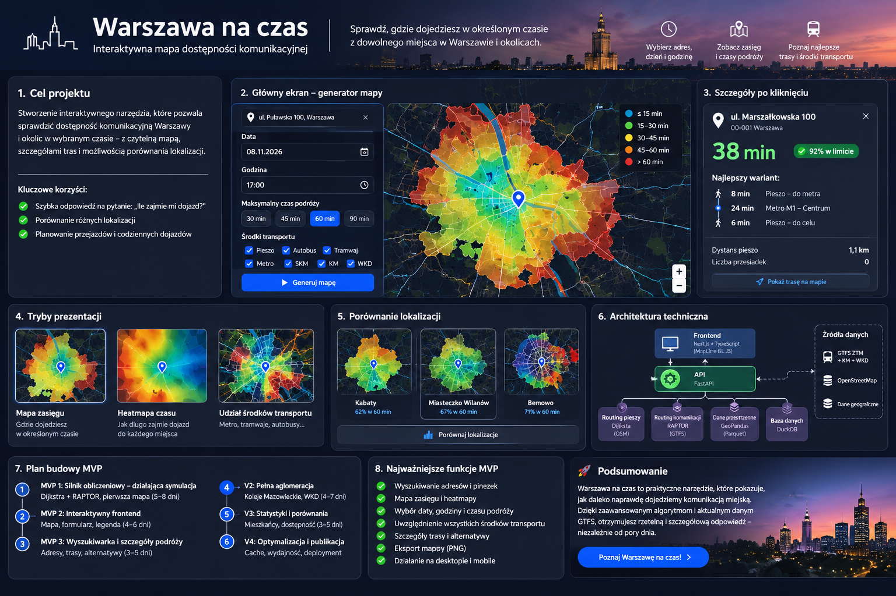
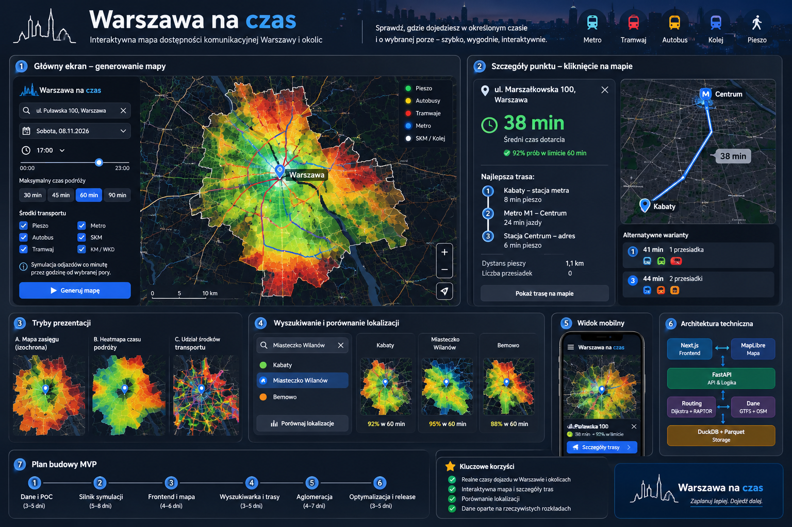
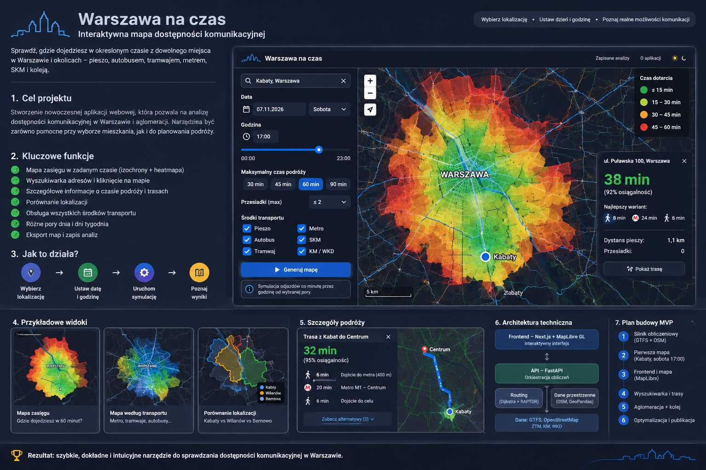
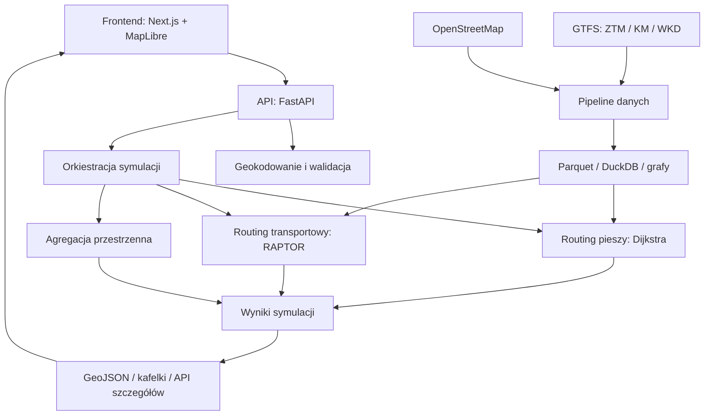

# Warszawa na czas

## Specyfikacja funkcjonalna i techniczna oraz plan budowy MVP

**Wersja:** 1.0\
**Data opracowania:** 1 listopada 2026 r.\
**Status:** specyfikacja koncepcyjna do rozpoczęcia implementacji

> **Cel projektu:** zbudowanie interaktywnej aplikacji webowej, która
> pozwala wskazać dowolny adres lub pinezkę na mapie, wybrać datę i
> godzinę, a następnie wygenerować mapę dostępności komunikacyjnej
> Warszawy i aglomeracji. Użytkownik może też kliknąć dowolne miejsce
> lub wyszukać adres docelowy, aby sprawdzić czas i szczegóły podróży.

## Spis treści

1.  [Podsumowanie produktu](#1-podsumowanie-produktu)
2.  [Kierunek UX i grafiki
    koncepcyjne](#2-kierunek-ux-i-grafiki-koncepcyjne)
3.  [Specyfikacja funkcjonalna](#3-specyfikacja-funkcjonalna)
4.  [Dane i źródła](#4-dane-i-źródła)
5.  [Architektura techniczna](#5-architektura-techniczna)
6.  [Silnik obliczeniowy](#6-silnik-obliczeniowy)
7.  [Model danych](#7-model-danych)
8.  [API](#8-api)
9.  [Wizualizacja i wydajność](#9-wizualizacja-i-wydajność)
10. [Plan budowy MVP](#10-plan-budowy-mvp)
11. [Kryteria akceptacji](#11-kryteria-akceptacji)
12. [Ograniczenia i ryzyka](#12-ograniczenia-i-ryzyka)
13. [Struktura repozytorium](#13-struktura-repozytorium)
14. [Poza zakresem MVP i dalszy
    rozwój](#14-poza-zakresem-mvp-i-dalszy-rozwój)
15. [Pierwszy sprint](#15-pierwszy-sprint)
16. [Decyzje do potwierdzenia](#16-decyzje-do-potwierdzenia)

------------------------------------------------------------------------

## 1. Podsumowanie produktu

### 1.1. Główna idea

„Warszawa na czas" to narzędzie do analizy dostępności transportowej.
Użytkownik podaje:

-   punkt początkowy: adres, nazwę miejsca albo pinezkę na mapie;
-   datę (dzień tygodnia jest wyliczany automatycznie);
-   godzinę rozpoczęcia podróży;
-   maksymalny czas podróży;
-   opcjonalnie liczbę przesiadek i środki transportu.

Aplikacja oblicza, do jakich obszarów i adresów można dotrzeć w zadanym
czasie, uwzględniając dojścia piesze, rozkłady jazdy, oczekiwanie,
przejazdy i przesiadki.

### 1.2. Uzgodnione założenia

-   **Forma:** aplikacja webowa, responsywna na desktopie i telefonie.
-   **Prezentacja:** mapa zasięgu (izochrony), heatmapa czasu oraz
    warstwa pokazująca udział środków transportu.
-   **Transport:** pieszo, autobusy, tramwaje, metro, SKM, Koleje
    Mazowieckie i WKD.
-   **Obszar:** Warszawa i aglomeracja warszawska.
-   **Główne zastosowania:** eksploracja dostępności oraz porównywanie
    lokalizacji, np. mieszkań.
-   **Wynik:** interaktywna mapa, możliwość sprawdzenia adresu,
    szczegóły trasy i eksport PNG.
-   **Podejście:** najpierw wiarygodny silnik obliczeniowy w Pythonie,
    potem interfejs webowy.

### 1.3. Główna wartość

Aplikacja ma odpowiadać na pytanie:

> „Ile naprawdę zajmie mi dojazd z tego konkretnego adresu do dowolnego
> innego miejsca w Warszawie, w wybranym dniu i o wybranej godzinie?"

Nie jest to nawigacja na żywo. Pierwsza wersja ma analizować planową
dostępność według rozkładów GTFS.

------------------------------------------------------------------------

## 2. Kierunek UX i grafiki koncepcyjne

Poniższe obrazy są **grafikami koncepcyjnymi UI/UX**, a nie zrzutami
działającej aplikacji. Służą jako punkt odniesienia dla projektu
interfejsu. Teksty i liczby widoczne w mockupach mogą być przykładowe.

### 2.1. Przegląd produktu



### 2.2. Dashboard, mapa i przepływy użytkownika



### 2.3. Układ aplikacji i szczegóły podróży



### 2.4. Główne zasady UX

-   Mapa jest głównym elementem ekranu.
-   Panel parametrów jest po lewej na desktopie, a na telefonie jako
    wysuwany panel.
-   Szczegóły klikniętego adresu otwierają się w panelu bocznym lub
    dolnym arkuszu.
-   Wyszukiwanie adresu docelowego jest dostępne bez konieczności
    ręcznego klikania w mapę.
-   Legenda musi jasno tłumaczyć kolory i metryki.
-   Użytkownik widzi datę i wersję wykorzystanych danych.
-   Każdy wynik powinien rozróżniać średni czas podróży od
    prawdopodobieństwa dotarcia w zadanym limicie.

------------------------------------------------------------------------

## 3. Specyfikacja funkcjonalna

### 3.1. Generator mapy

  -----------------------------------------------------------------------
  Parametr                            Wymaganie
  ----------------------------------- -----------------------------------
  Punkt początkowy                    Wyszukiwanie adresu, nazwy miejsca
                                      lub pinezka na mapie

  Data                                Konkretna data z kalendarza

  Dzień tygodnia                      Wyliczany automatycznie z daty

  Godzina                             00:00--23:59

  Maksymalny czas podróży             15, 30, 45, 60, 90 lub 120 minut

  Maksymalna liczba przesiadek        0--3

  Środki transportu                   Pieszo, autobus, tramwaj, metro,
                                      SKM, KM, WKD

  Okno symulacji                      Np. 1, 15, 30 lub 60 minut od
                                      wskazanej godziny

  Metryka mapy                        Średni czas, prawdopodobieństwo
                                      osiągnięcia celu lub udział
                                      transportu
  -----------------------------------------------------------------------

**Dlaczego konkretna data zamiast samego dnia tygodnia?**\
Rozkłady mogą różnić się w święta, ferie, wakacje i dni ze specjalnym
kalendarzem. Konkretna data umożliwia prawidłowe odczytanie
`calendar.txt` i `calendar_dates.txt` w GTFS. Można dodać szybkie
presety typu „typowa sobota" lub „typowy dzień roboczy".

### 3.2. Tryby prezentacji mapy

#### A. Mapa zasięgu (izochrony)

Pokazuje obszary osiągalne w kolejnych przedziałach czasu, np.:

-   do 15 minut;
-   15--30 minut;
-   30--45 minut;
-   45--60 minut;
-   powyżej limitu / poza zasięgiem.

Paleta kolorów powinna być czytelna na ciemnym i jasnym podkładzie oraz
dostępna dla osób z zaburzeniami rozpoznawania barw.

#### B. Heatmapa czasu podróży

Każdy punkt lub komórka siatki otrzymuje kolor odpowiadający średniemu
czasowi dotarcia. Pozwala to zobaczyć różnice wewnątrz całego obszaru,
nie tylko granicę izochrony.

#### C. Udział środków transportu

Warstwa prezentująca udział poszczególnych środków transportu w czasie
podróży:

-   pieszo;
-   autobus;
-   tramwaj;
-   metro;
-   SKM;
-   Koleje Mazowieckie;
-   WKD.

Należy rozróżnić **najlepszy wariant podróży** od **udziału czasowego
środków transportu**. Kolor nie może oznaczać jedynie tego, że dany
środek transportu występuje gdzieś w pobliżu.

### 3.3. Interakcje z mapą

Użytkownik może:

-   przesuwać i przybliżać mapę;
-   kliknąć dowolny punkt;
-   zobaczyć adres przez reverse geocoding;
-   sprawdzić średni czas dotarcia i prawdopodobieństwo dotarcia w
    limicie;
-   zobaczyć najlepszą trasę i alternatywy;
-   włączyć lub wyłączyć warstwy;
-   zmienić przedział czasu;
-   wyszukać adres docelowy w osobnym polu.

**Ważne:** kliknięcie nie może opierać się wyłącznie na kolorze piksela
lub interpolacji heatmapy. Backend powinien móc wykonać dokładne
zapytanie dla wskazanych współrzędnych.

### 3.4. Szczegóły podróży

Dla wybranego adresu docelowego aplikacja prezentuje:

-   adres docelowy;
-   średni czas podróży;
-   odsetek symulacji, w których cel osiągnięto w zadanym limicie;
-   dojście do pierwszego przystanku;
-   czas oczekiwania;
-   czas przejazdu;
-   czas i liczbę przesiadek;
-   dojście z przystanku końcowego;
-   wykorzystane linie i przystanki;
-   dystans pieszy;
-   alternatywne warianty;
-   trasę narysowaną na mapie.

Przykładowy, ilustracyjny wariant:

1.  8 min pieszo do stacji metra;
2.  24 min metrem M1;
3.  6 min pieszo do adresu docelowego;
4.  łącznie 38 min.

Wartości powyżej są przykładowe i nie stanowią wyniku rzeczywistej
symulacji.

### 3.5. Porównywanie lokalizacji

Funkcja planowana po MVP, ale uwzględniona w architekturze.

Przykładowo: Kabaty vs Miasteczko Wilanów vs Bemowo. Dla wszystkich
lokalizacji można uruchomić identyczne scenariusze i porównać:

-   odsetek punktów osiągalnych w 30/45/60 minut;
-   liczbę osiągalnych przystanków i linii;
-   powierzchnię obszaru dostępności;
-   dostępność wybranych punktów POI;
-   liczbę mieszkańców osiągalnych w zadanym czasie, jeśli zostaną
    dodane odpowiednie dane demograficzne.

### 3.6. Zapisywanie i eksport

Docelowo:

-   zapis analizy;
-   ponowne otwieranie analizy;
-   duplikowanie i modyfikowanie parametrów;
-   eksport PNG w wysokiej rozdzielczości;
-   udostępnianie linku z parametrami analizy.

Link powinien przechowywać identyfikator analizy lub parametry, a nie
wyłącznie obraz mapy.

------------------------------------------------------------------------

## 4. Dane i źródła

### 4.1. Źródła danych

  -----------------------------------------------------------------------
  Źródło                  Zakres                  Rola
  ----------------------- ----------------------- -----------------------
  GTFS ZTM Warszawa       Autobusy, tramwaje,     Podstawowy transport
                          metro i dane            miejski
                          publikowane przez ZTM   

  GTFS Kolei Mazowieckich Kolej regionalna        Połączenia
                                                  aglomeracyjne

  GTFS WKD                Warszawska Kolej        Połączenia podmiejskie
                          Dojazdowa               

  OpenStreetMap           Chodniki, przejścia,    Routing pieszy i mapa
                          ścieżki, ulice,         
                          geometrie               

  Dane przestrzenne       Granice, siatki,        Agregacja i statystyki
                          opcjonalnie budynki i   
                          populacja               
  -----------------------------------------------------------------------

Źródła należy zweryfikować przed implementacją pod kątem dostępności,
aktualności, kompletności, licencji i warunków redystrybucji. Nie należy
zakładać, że wszystkie feedy są jednakowo kompletne lub aktualizowane w
tym samym cyklu.

### 4.2. Normalizacja wielu feedów

Nie należy bezrefleksyjnie scalać plików GTFS. Potrzebna jest warstwa
normalizująca:

-   identyfikatory operatorów i feedów;
-   identyfikatory przystanków i stacji;
-   nazwy i typy linii;
-   kursy i kalendarze;
-   perony i stanowiska;
-   transfery i dojścia pomiędzy przystankami;
-   duplikaty i różnice w nazewnictwie.

Przystanek, zespół przystankowy, peron i stacja powinny być osobnymi
pojęciami w modelu. To ważne przy obliczaniu rzeczywistych czasów
przesiadek.

### 4.3. Pipeline aktualizacji

1.  Sprawdzenie dostępności nowych feedów.
2.  Pobranie i archiwizacja oryginalnych plików.
3.  Walidacja struktury GTFS i spójności danych.
4.  Normalizacja operatorów i identyfikatorów.
5.  Budowa indeksów kursów, przystanków i połączeń.
6.  Publikacja nowej wersji danych.
7.  Zachowanie poprzedniej wersji, aby móc odtworzyć wcześniejsze
    wyniki.

Docelowo import może być wykonywany codziennie, ale częstotliwość
powinna wynikać z realnego cyklu aktualizacji źródeł.

------------------------------------------------------------------------

## 5. Architektura techniczna

### 5.1. Proponowany stack

  -----------------------------------------------------------------------
  Warstwa                 Technologia             Zastosowanie
  ----------------------- ----------------------- -----------------------
  Frontend                Next.js + TypeScript    Aplikacja webowa

  UI                      Tailwind CSS +          Komponenty i stylowanie
                          shadcn/ui               

  Mapa                    MapLibre GL JS          Mapa, warstwy i
                                                  interakcje

  Backend                 Python + FastAPI        API i orkiestracja
                                                  obliczeń

  Routing pieszy          Dijkstra, NetworkX lub  Sieć piesza
                          wyspecjalizowany silnik 

  Routing transportowy    RAPTOR                  Rozkłady i przesiadki

  Dane przestrzenne       GeoPandas, Shapely      Geometrie i agregacja

  Dane analityczne        DuckDB + Parquet        Przechowywanie i
                                                  analiza

  Cache                   Redis (później)         Cache wyników i zadań

  Testy                   Pytest, Playwright      Testy backendu i UI

  Środowisko              Docker / Docker Compose Powtarzalne
                                                  uruchamianie
  -----------------------------------------------------------------------

Na początku nie jest potrzebny Databricks ani rozbudowana infrastruktura
chmurowa. Nie należy też wprowadzać mikroserwisów bez realnej potrzeby.

### 5.2. Logiczny przepływ



### 5.3. Geokodowanie

Użytkownik może wpisać adres, nazwę miejsca lub wskazać pinezkę.

Proces:

1.  Geokoder zwraca kandydatów.
2.  Użytkownik wybiera właściwy adres.
3.  Aplikacja pokazuje pinezkę na mapie.
4.  Użytkownik może skorygować położenie.
5.  Współrzędne trafiają do silnika.

Publiczny Nominatim nie powinien być traktowany jako bezlimitowy serwis
autocomplete. Trzeba przestrzegać polityki użycia, cache'ować wyniki i
rozważyć własną instancję lub innego dostawcę w produkcji.

### 5.4. Routing pieszy

Z danych OpenStreetMap należy zbudować graf pieszy:

-   węzły: skrzyżowania i punkty połączeń;
-   krawędzie: chodniki, ścieżki, przejścia i dostępne odcinki;
-   atrybuty: długość, czas, typ drogi, schody, dostępność i
    ograniczenia.

Początkowa prędkość marszu może wynosić np. 4,5 km/h, ale musi być
parametrem konfiguracyjnym, nie stałą zaszytą w kodzie.

Schody, przejścia z sygnalizacją i dojścia między peronami powinny mieć
dodatkowy koszt czasowy, o ile dane są dostępne. Należy unikać tras
przez obszary niedostępne dla pieszych.

### 5.5. Routing transportowy -- RAPTOR

RAPTOR wyszukuje podróże w rozkładach jazdy, zwiększając liczbę
obsługiwanych przesiadek w kolejnych rundach.

-   runda 0 -- dojście piesze, bez pojazdu;
-   runda 1 -- podróż bez przesiadki;
-   runda 2 -- jedna przesiadka;
-   runda 3 -- dwie przesiadki;
-   runda 4 -- trzy przesiadki.

Liczbę przesiadek należy rozumieć jako zmianę pojazdu lub kursu, a nie
automatycznie jako zmianę operatora. Czas przesiadki powinien wynikać z
rzeczywistego dojścia pomiędzy peronami i stanowiskami, a nie wyłącznie
ze stałego bufora.

### 5.6. Pełny proces obliczenia podróży

``` text
Punkt początkowy
      |
      v
Routing pieszy (Dijkstra)
      |
      v
Osiągalne przystanki początkowe
      |
      v
Routing transportowy (RAPTOR)
      |
      v
Osiągalne przystanki docelowe
      |
      v
Routing pieszy do punktów docelowych
      |
      v
Czas podróży i warianty tras
```

------------------------------------------------------------------------

## 6. Silnik obliczeniowy

### 6.1. Znajdowanie przystanków początkowych

Nie wystarczy wyszukać przystanków w promieniu np. 500 metrów w linii
prostej. Należy obliczyć rzeczywisty czas dojścia po grafie pieszym.

Każdy osiągalny przystanek jest kandydatem na punkt wejścia do
transportu publicznego.

### 6.2. Symulacja wielu godzin odjazdu

Domyślna metoda zgodna z inspiracją oryginalnego projektu:

-   użytkownik wybiera godzinę, np. sobota 17:00;
-   silnik wykonuje symulacje dla kolejnych minut w oknie 60-minutowym;
-   dla każdej symulacji oblicza osiągalność i czasy;
-   wyniki są agregowane.

Przykładowe okno: 17:00, 17:01, 17:02, ..., 17:59.

Okno symulacji powinno być konfigurowalne. Trzeba też jasno określić
semantykę: czy każda symulacja oznacza osobę rozpoczynającą podróż w
danej minucie, czy analizę konkretnego odjazdu. Rekomendowane jest
pierwsze podejście.

### 6.3. Metryki

Nie należy pokazywać wyłącznie jednej średniej.

Dla każdego punktu docelowego warto wyliczyć:

-   liczbę prób;
-   liczbę prób zakończonych dotarciem;
-   średni czas wśród prób zakończonych dotarciem;
-   medianę i percentyle czasu;
-   odsetek prób, w których dotarto w zadanym limicie;
-   średni czas dojścia pieszego;
-   średni czas oczekiwania;
-   średni czas jazdy;
-   średnią liczbę przesiadek.

Przykładowe definicje:

`T_avg` = średni czas podróży wśród prób, w których cel został
osiągnięty.

`P_limit` = liczba prób zakończonych dotarciem w limicie / liczba
wszystkich prób.

Jeśli cel osiągnięto w 40 z 60 prób, `P_limit` wynosi 66,7%. Nie wolno
prezentować średniej z tych 40 prób jako pełnej gwarancji dostępności.

### 6.4. Rozdzielenie metryk transportowych

Warstwa transportowa powinna rozróżniać:

1.  **Najlepszy wariant:** środek transportu lub sekwencja środków w
    najszybszej podróży.
2.  **Udział czasowy:** czas przypadający na chodzenie, autobus,
    tramwaj, metro i kolej.
3.  **Częstość wyboru wariantu:** jak często dany środek występuje w
    najlepszej trasie w próbach symulacyjnych.

Dzięki temu kolory mapy będą miały jednoznaczne znaczenie.

------------------------------------------------------------------------

## 7. Model danych

### 7.1. Przechowywanie

Na początek rekomendowane są Parquet i DuckDB. PostgreSQL/PostGIS można
rozważyć później, jeśli pojawi się potrzeba współbieżnego zapisu,
zaawansowanych zapytań przestrzennych lub wielu użytkowników.

### 7.2. Struktura katalogów danych

``` text
data/
├── raw/
│   ├── gtfs/
│   │   ├── ztm/
│   │   ├── km/
│   │   └── wkd/
│   └── osm/
├── processed/
│   ├── stops.parquet
│   ├── routes.parquet
│   ├── trips.parquet
│   ├── stop_times.parquet
│   ├── calendars.parquet
│   ├── walking_graph/
│   └── transit_graph/
├── simulations/
│   ├── metadata/
│   ├── results/
│   └── geometries/
└── exports/
```

### 7.3. Główne encje

  Encja               Przykładowe pola
  ------------------- --------------------------------------------------
  `transport_stop`    stop_id, name, lat, lon, operator_id
  `stop_group`        group_id, name, geometry
  `transport_route`   route_id, line_name, transport_type, operator_id
  `transport_trip`    trip_id, route_id, service_id
  `stop_time`         trip_id, stop_id, arrival_time, departure_time
  `walking_edge`      source, target, distance, duration, attributes
  `simulation`        id, origin, date, time, parameters, data_version
  `reachability`      simulation_id, target_id, avg_time, p_limit
  `journey`           origin, destination, segments, duration

W modelu należy zachować identyfikator źródłowego feedu i operatora, aby
uniknąć kolizji identyfikatorów między GTFS.

------------------------------------------------------------------------

## 8. API

Proponowane endpointy:

  ----------------------------------------------------------------------------------
  Endpoint                           Metoda                  Funkcja
  ---------------------------------- ----------------------- -----------------------
  `/api/geocode`                     GET                     Wyszukiwanie adresu

  `/api/reverse-geocode`             GET                     Zamiana pinezki na
                                                             adres

  `/api/simulations`                 POST                    Uruchomienie symulacji

  `/api/simulations/{id}`            GET                     Status i parametry

  `/api/simulations/{id}/map`        GET                     Dane do wizualizacji

  `/api/simulations/{id}/point`      GET                     Dokładne dane dla
                                                             punktu

  `/api/simulations/{id}/journeys`   GET                     Szczegóły i alternatywy
                                                             tras

  `/api/data/status`                 GET                     Status i aktualność
                                                             danych
  ----------------------------------------------------------------------------------

### 8.1. Przykładowe żądanie

``` json
{
  "origin": {
    "lat": 52.162,
    "lon": 21.027
  },
  "date": "2026-11-07",
  "departure_time": "17:00",
  "departure_window_minutes": 60,
  "max_travel_time_minutes": 60,
  "max_transfers": 2,
  "transport_modes": [
    "walk",
    "bus",
    "tram",
    "metro",
    "skm",
    "km",
    "wkd"
  ],
  "aggregation": "mean"
}
```

### 8.2. Przykładowa odpowiedź

``` json
{
  "simulation_id": "sim_123",
  "status": "completed",
  "data_version": "2026-11-07",
  "origin": {
    "lat": 52.162,
    "lon": 21.027
  },
  "results": {
    "average_travel_time": 38.5,
    "reachable_probability": 0.92,
    "average_transfers": 1.1
  },
  "map_data_url": "/api/simulations/sim_123/map"
}
```

To przykładowy kontrakt API, a nie rzeczywisty wynik obliczeń.

------------------------------------------------------------------------

## 9. Wizualizacja i wydajność

### 9.1. Generowanie mapy

Nie należy uruchamiać pełnego algorytmu od zera przy każdym kliknięciu w
mapę.

Proponowane dwa poziomy:

**Warstwa 1 -- mapa ogólna** - obliczenie dostępności dla siatki
przestrzennej, np. komórek 100 × 100 m; - agregacja metryk; -
generowanie GeoJSON lub kafelków wektorowych; - renderowanie warstw w
MapLibre.

**Warstwa 2 -- dokładne zapytanie** - użytkownik klika punkt lub
wyszukuje adres; - backend dopasowuje współrzędne do grafu pieszego; -
wykonywane jest dokładne obliczenie czasu i trasy; - zwracane są
szczegóły i alternatywy.

Siatka 100 × 100 m jest punktem startowym do testów, nie ostatecznym
założeniem. Rozdzielczość należy dobrać do wydajności i dokładności
danych OSM.

### 9.2. Cache i ponowne wykorzystanie wyników

Klucz cache powinien uwzględniać co najmniej:

-   punkt początkowy lub jego znormalizowaną komórkę;
-   datę i godzinę;
-   okno symulacji;
-   limit czasu;
-   liczbę przesiadek;
-   włączone środki transportu;
-   wersję danych GTFS i OSM;
-   wersję parametrów routingu.

Nie wolno zwracać wyniku z cache, jeśli bazuje na innej wersji
rozkładów.

### 9.3. Wydajność

Najpierw należy zmierzyć czas obliczeń dla jednego punktu i jednego
scenariusza. Dopiero na podstawie pomiarów dobrać:

-   indeksy przystanków;
-   prekomputację;
-   równoległość;
-   cache;
-   rozdzielczość siatki;
-   osobny worker do zadań.

Dla dłuższych symulacji API powinno zwracać identyfikator zadania i
status, zamiast blokować połączenie HTTP przez cały czas obliczeń.

------------------------------------------------------------------------

## 10. Plan budowy MVP

Szacunek dla jednej osoby technicznej, korzystającej z istniejących
bibliotek i dostępnych feedów. To orientacyjny nakład, nie gwarantowany
harmonogram.

### Etap 0 -- przygotowanie danych i proof of concept (3--5 dni)

**Cel:** sprawdzić możliwość poprawnego policzenia dostępności z jednego
punktu.

Zadania: - utworzenie repozytorium; - pobranie GTFS Warszawy; - pobranie
danych OSM; - walidacja podstawowych plików GTFS; - zbudowanie grafu
pieszego; - załadowanie rozkładów; - test routingu z Kabat; - ręczna
weryfikacja wybranych tras.

**Rezultat:** notebook lub skrypt Python, który oblicza osiągalne
przystanki i czasy podróży.

### Etap 1 -- silnik symulacyjny (5--8 dni)

**Cel:** wygenerować pierwszą prawdziwą mapę.

Zadania: - routing Dijkstra + RAPTOR; - obsługa kalendarzy i wyjątków; -
symulacja wielu godzin rozpoczęcia podróży; - obliczanie średniego czasu
i prawdopodobieństwa dotarcia; - agregacja wyników do siatki; -
generowanie GeoJSON.

**Rezultat:** mapa dostępności z Kabat dla soboty o 17:00.

### Etap 2 -- frontend i interaktywna mapa (4--6 dni)

**Cel:** korzystanie z silnika bez uruchamiania Pythona ręcznie.

Zadania: - Next.js i TypeScript; - integracja MapLibre; - formularz
parametrów; - warstwy mapy; - legenda; - kliknięcie punktu; - status
obliczeń.

**Rezultat:** pierwsza działająca aplikacja webowa.

### Etap 3 -- wyszukiwarka adresów i szczegóły podróży (3--5 dni)

**Cel:** możliwość sprawdzania dowolnego adresu.

Zadania: - geokodowanie i reverse geocoding; - szczegółowe trasy; -
alternatywne warianty; - rozbicie czasu podróży; - wizualizacja trasy.

**Rezultat:** realizacja głównego wymagania użytkownika.

### Etap 4 -- pełna aglomeracja (4--7 dni)

**Cel:** rozszerzenie zakresu transportu i geografii.

Zadania: - integracja Kolei Mazowieckich; - integracja WKD; - przesiadki
między operatorami; - rozszerzenie grafu OSM; - testy połączeń poza
Warszawą.

**Rezultat:** Warszawa i aglomeracja.

### Etap 5 -- jakość, wydajność i publikacja (3--5 dni)

**Cel:** przygotowanie aplikacji do regularnego używania.

Zadania: - cache; - optymalizacja; - eksport PNG; - zapis analiz; -
testy mobilne; - deployment; - automatyczna aktualizacja danych.

**Rezultat:** działająca aplikacja dostępna przez przeglądarkę.

### Podsumowanie nakładu

  Etap                               Szacunkowy czas
  -------------------------------- -----------------
  0\. Dane i PoC                            3--5 dni
  1\. Silnik symulacyjny                    5--8 dni
  2\. Frontend i mapa                       4--6 dni
  3\. Adresy i trasy                        3--5 dni
  4\. Aglomeracja                           4--7 dni
  5\. Optymalizacja i publikacja            3--5 dni
  **Łącznie**                         **22--36 dni**

Największa niepewność dotyczy integracji feedów, jakości danych
przesiadkowych i wydajności symulacji.

------------------------------------------------------------------------

## 11. Kryteria akceptacji

MVP można uznać za działające, gdy spełnia poniższe warunki:

  ID      Kryterium                Warunek zaliczenia
  ------- ------------------------ ------------------------------------------------
  AC-01   Lokalizacja początkowa   Adres i pinezka działają
  AC-02   Data i godzina           Poprawna obsługa daty i kalendarza GTFS
  AC-03   Rozkłady                 Uwzględnione kursy i wyjątki
  AC-04   Routing pieszy           Trasy po realnej sieci dojść
  AC-05   Routing transportowy     Poprawne kursy i przesiadki
  AC-06   Symulacja                Możliwość analizy kolejnych minut w oknie
  AC-07   Mapa                     Izochrony i heatmapa
  AC-08   Kliknięcie               Adres i czas dotarcia dla punktu
  AC-09   Szczegóły                Możliwość zobaczenia przebiegu podróży
  AC-10   Aktualność               Widoczna wersja danych i data importu
  AC-11   Transport                ZTM oraz kolej regionalna w ustalonym zakresie
  AC-12   Eksport                  Zapis mapy do PNG

### Scenariusze testowe

-   Kabaty → Centrum, sobota 17:00.
-   Kabaty → Centrum, sobota 02:00.
-   Wilanów → Centrum, sobota 17:00.
-   Piaseczno → Centrum, dzień roboczy.
-   Lokalizacja o ograniczonej dostępności nocnej.

Wyniki należy porównywać z rozkładami i ręcznie sprawdzonymi trasami.
Celem jest poprawność względem używanych danych, a nie identyczność z
Google Maps.

------------------------------------------------------------------------

## 12. Ograniczenia i ryzyka

### 12.1. Rozkład planowy a rzeczywisty transport

Pierwsza wersja bazuje na statycznych rozkładach GTFS. Nie uwzględnia
automatycznie korków, opóźnień, awarii ani nieplanowanych objazdów.

Dane GTFS-Realtime można rozważyć w kolejnej wersji, jeśli będą dostępne
i odpowiednio kompletne.

### 12.2. Średni czas a niezawodność

Średni czas należy pokazywać razem z odsetkiem prób zakończonych
dotarciem w limicie. Średnia liczona wyłącznie z udanych prób nie
oznacza, że cel jest zawsze osiągalny.

### 12.3. Przesiadki

Przesiadki powinny uwzględniać rzeczywisty czas przejścia pomiędzy
peronami i stanowiskami. Sam fakt, że dwa kursy zatrzymują się w tym
samym zespole przystankowym, nie oznacza automatycznie wygodnej
przesiadki.

### 12.4. Jakość OSM

Dane o chodnikach i przejściach mogą być niekompletne. Należy testować
graf, wykrywać anomalie i umożliwić aktualizację danych.

### 12.5. Licencje

Przed publikacją należy zweryfikować warunki użycia i redystrybucji
każdego feedu, a także wymagania atrybucji OpenStreetMap. Należy
zachować informacje o źródłach i wersjach danych.

------------------------------------------------------------------------

## 13. Struktura repozytorium

Proponowane monorepo:

``` text
warszawa-na-czas/
├── apps/
│   ├── web/
│   │   ├── app/
│   │   ├── components/
│   │   ├── features/
│   │   │   ├── map/
│   │   │   ├── search/
│   │   │   ├── simulation/
│   │   │   └── journey/
│   │   └── lib/
│   └── api/
│       ├── routers/
│       ├── services/
│       ├── schemas/
│       └── main.py
├── packages/
│   ├── routing/
│   │   ├── pedestrian/
│   │   └── transit/
│   ├── gtfs/
│   │   ├── ingestion/
│   │   ├── normalization/
│   │   └── validation/
│   ├── spatial/
│   └── simulation/
├── data/
├── tests/
│   ├── unit/
│   ├── integration/
│   └── fixtures/
├── scripts/
├── docker/
├── docs/
├── docker-compose.yml
└── README.md
```

### Zasady architektoniczne

-   Jeden modularny backend FastAPI na start.
-   Silnik routingu niezależny od frontendu.
-   Dane źródłowe oddzielone od przetworzonych.
-   Każda symulacja zapisuje wersję danych i parametry.
-   Długie zadania wykonywane asynchronicznie.
-   Interfejs nie zna szczegółów implementacji RAPTOR ani Dijkstry.

------------------------------------------------------------------------

## 14. Poza zakresem MVP i dalszy rozwój

  Funkcja                         Priorytet
  ------------------------------- ------------------------------
  Generator mapy                  MVP
  Adres i pinezka                 MVP
  ZTM i kolej regionalna          MVP -- z etapowym wdrożeniem
  Szczegóły adresu i podróży      MVP
  Izochrony i heatmapa            MVP
  Udział środków transportu       MVP
  Eksport PNG                     MVP
  Porównywanie lokalizacji        V2
  Statystyki mieszkańców          V2
  Dane rzeczywiste i opóźnienia   V2
  Analiza różnych pór roku        V2
  Zapis ulubionych lokalizacji    V2
  Inne miasta w Polsce            V3

------------------------------------------------------------------------

## 15. Pierwszy sprint

### Sprint 1 -- Transport data foundation

**Cel:** mieć lokalne, powtarzalne środowisko do przetwarzania
warszawskich rozkładów.

Checklist:

-   [ ] Utworzyć repozytorium `warszawa-na-czas`.
-   [ ] Skonfigurować Python i środowisko projektu.
-   [ ] Pobrać i zarchiwizować GTFS Warszawy.
-   [ ] Sprawdzić dostępność GTFS Kolei Mazowieckich.
-   [ ] Sprawdzić dostępność GTFS WKD.
-   [ ] Zbudować walidator plików GTFS.
-   [ ] Znormalizować `stops`, `routes`, `trips` i `stop_times`.
-   [ ] Sprawdzić poprawność kalendarzy i wyjątków.
-   [ ] Przygotować raport liczby linii, przystanków i kursów.
-   [ ] Zapisać wersję źródeł i datę pobrania.

**Definition of Done:** - import jest powtarzalny; - błędne lub
niekompletne feedy są raportowane; - dane są zapisane w ustandaryzowanym
formacie; - można odtworzyć, z jakich feedów powstał dany zestaw
danych; - raport pokazuje zakres dat i podstawowe statystyki.

### Następny sprint

Po zakończeniu fundamentu danych należy zbudować graf pieszy dla obszaru
testowego Kabat i uruchomić pierwsze obliczenie dostępności. Dopiero po
zweryfikowaniu wyników warto przejść do pełnej mapy.

------------------------------------------------------------------------

## 16. Decyzje do potwierdzenia

Poniższe kwestie nie blokują rozpoczęcia prac, ale powinny zostać
ustalone przed zamknięciem MVP:

1.  **Średnia czy percentyl jako główna mapa:** rekomendacja -- średni
    czas, z osobną warstwą prawdopodobieństwa dotarcia w limicie.
2.  **Okno symulacji:** domyślnie 60 minut od wybranej godziny, z
    możliwością zmiany.
3.  **Domyślna liczba przesiadek:** rekomendacja -- maksymalnie 2, z
    możliwością ustawienia 0--3.
4.  **Dostawca geokodowania:** na początek rozwiązanie zgodne z zasadami
    użycia OSM, później ewentualnie własna instancja.
5.  **Hosting:** lokalnie na etapie PoC; wybór hostingu po pomiarach
    wydajności.
6.  **Dane kolejowe:** potwierdzenie dostępności, jakości i licencji
    feedów KM i WKD.

------------------------------------------------------------------------

## Podsumowanie

„Warszawa na czas" powinno być narzędziem do rzeczywistej analizy
dostępności komunikacyjnej, a nie tylko generatorem ładnych map.

Najważniejsza kolejność realizacji:

1.  **Dane:** GTFS + OpenStreetMap.
2.  **Silnik:** routing pieszy + RAPTOR.
3.  **Symulacja:** wiele minut rozpoczęcia podróży i agregacja wyników.
4.  **Mapa:** izochrony, heatmapa i warstwa transportu.
5.  **Adresy:** dokładne czasy, trasy i alternatywy.
6.  **Aplikacja:** responsywny frontend i eksport.
7.  **Aglomeracja:** integracja i walidacja wszystkich operatorów.

**Najważniejsza zasada:** najpierw wiarygodność obliczeń, potem
optymalizacja i dopracowanie interfejsu.

------------------------------------------------------------------------

## Materiały i biblioteki do weryfikacji

Poniższe adresy są punktami startowymi do sprawdzenia dokumentacji i
aktualnych warunków użycia przed implementacją:

-   [GTFS -- oficjalna
    dokumentacja](https://gtfs.org/documentation/schedule/)
-   [OpenStreetMap](https://www.openstreetmap.org/)
-   [OSMnx](https://osmnx.readthedocs.io/)
-   [MapLibre GL JS](https://maplibre.org/maplibre-gl-js/docs/)
-   [FastAPI](https://fastapi.tiangolo.com/)
-   [DuckDB](https://duckdb.org/docs/)
-   [GeoPandas](https://geopandas.org/)
-   [NetworkX](https://networkx.org/documentation/stable/)
-   [Nominatim Usage
    Policy](https://operations.osmfoundation.org/policies/nominatim/)
-   [OpenStreetMap Copyright and
    License](https://www.openstreetmap.org/copyright)

**Uwaga:** dostępność feedów, ich zakres, aktualność i warunki
licencyjne należy zweryfikować w chwili implementacji. Dokument jest
specyfikacją projektu, a nie potwierdzeniem, że wszystkie integracje
zostały już przetestowane.
